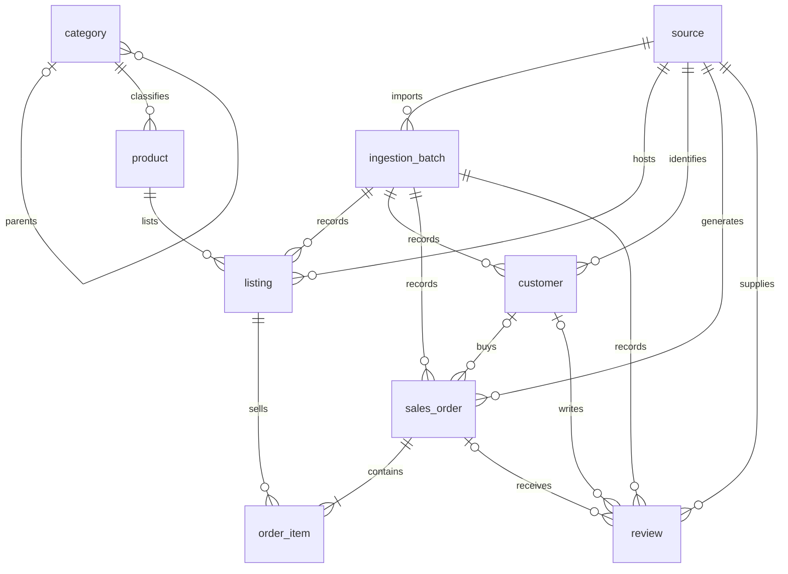

# Database Specification

SprintHack@ND 2026 — Goodwill Michiana. Condensed implementation contract;
preserves the attached design without resolving its open decisions.

## 1. Scope and conventions

- **Database:** PostgreSQL; one common relational schema for Amazon, eBay,
  ShopGoodwill, and future sources. After normalization, it is the application's
  source of truth.
- **Flow:** source files → ingest/archive → normalize/enrich → database → backend
  business rules → daily/monthly dashboards.
- Preserve untouched source files and historical orders/listings. Later imports
  update matching entities; they must not replace the historical dataset.
- Store facts; derive business metrics through backend queries/views. The agreed
  monetary aggregation object is `sales_order_mv`.
- `product` = physical item; `listing` = marketplace sale attempt;
  `sales_order` = transaction header; `order_item` = sold listing within an order.
- Internal keys are `BIGINT` surrogate IDs, separate from external marketplace
  IDs. External IDs are `TEXT` and unique only within their source.
- All tables/columns/indexes/constraints/migrations use `snake_case`; use the
  exact singular table names below, including `sales_order`, not `order`.
- Monetary values use unconstrained PostgreSQL `NUMERIC`, never floating point.
  Keys use PostgreSQL identity columns and timestamps use `TIMESTAMPTZ`
  (resolved in `DECISIONS.md`, D019).
- In the tables below, **Required** means `NOT NULL`; **Optional** means nullable.
  **Timestamp** denotes `TIMESTAMPTZ`.
  Defaults are not agreed. A known true zero may be stored as `0`; missing data
  must not be silently defaulted to zero.

## 2. Relationships



Each required FK references exactly one parent; each optional FK references zero
or one. Parents may have many children. An order conceptually contains one or more
items; ordinary FKs alone do not enforce that minimum. A listing normally has one
successful sale for a unique donated item, but the schema permits multiple
`order_item` rows: **do not add `UNIQUE(order_item.listing_id)`**.

KPI join path: `sales_order → order_item → listing → product → category`.
The materialized view derives one row per `sales_order`.

## 3. Persistent tables

PK and UNIQUE constraints provide their own indexes. Additional indexes below
retain the original specification's intended query/access paths.

### 3.1 `source` — marketplace identity

| Column | Type | Nullability | Meaning / constraint |
|---|---|---|---|
| `source_id` | `BIGINT` | Required | PK |
| `name` | `TEXT` | Required | Human-readable marketplace name; UNIQUE |

No FKs or additional checks/indexes required. Seed Amazon, eBay, ShopGoodwill.
Use `source_id` for relationships rather than marketplace names as FKs.

### 3.2 `ingestion_batch` — imported file/run and archive provenance

| Column | Type | Nullability | Meaning / constraint |
|---|---|---|---|
| `batch_id` | `BIGINT` | Required | PK |
| `source_id` | `BIGINT` | Required | FK → `source.source_id` |
| `file_name` | `TEXT` | Required | Original source filename |
| `archived_path` | `TEXT` | Required | Untouched source file's archive location |
| `ingested_at` | Timestamp | Required | Ingestion time |
| `period_start` | `DATE` | Optional | Reporting period start |
| `period_end` | `DATE` | Optional | Reporting period end |

- Suggested check: `period_end >= period_start` when both are present.
- Indexes: `source_id`, `ingested_at`.
- File-level duplicate detection is open; no hash/fingerprint column was agreed.

### 3.3 `category` — canonical hierarchical taxonomy

| Column | Type | Nullability | Meaning / constraint |
|---|---|---|---|
| `category_id` | `BIGINT` | Required | PK |
| `parent_category_id` | `BIGINT` | Optional | FK → `category.category_id`; NULL for roots |
| `name` | `TEXT` | Required | Canonical category name |

Indexes: `parent_category_id`, `name`. Use this self-reference rather than separate
category/subcategory tables. Map marketplace categories into this taxonomy.

### 3.4 `product` — physical Goodwill item

| Column | Type | Nullability | Meaning / constraint |
|---|---|---|---|
| `product_id` | `BIGINT` | Required | PK |
| `sku_number` | `TEXT` | Required | Stable Goodwill/internal item identifier |
| `product_name` | `TEXT` | Required | Normalized item name |
| `category_id` | `BIGINT` | Required | FK → `category.category_id` |

- Indexes: `category_id`, `sku_number`.
- `UNIQUE(sku_number)` is conditional on confirming global SKU uniqueness (§9).
- Retain the reviewed names: `sku_number` replaces `internal_item_id`;
  `product_name` replaces `title`.
- No price column: realized price belongs in `order_item.unit_price`.
  Auction starting/fixed asking prices are not in the agreed schema.

### 3.5 `listing` — one marketplace sale attempt

| Column | Type | Nullability | Meaning / constraint |
|---|---|---|---|
| `listing_id` | `BIGINT` | Required | PK |
| `product_id` | `BIGINT` | Required | FK → `product.product_id` |
| `source_id` | `BIGINT` | Required | FK → `source.source_id` |
| `source_listing_id` | `TEXT` | Required | Marketplace listing ID |
| `listed_at` | Timestamp | Required | Activation time |
| `ended_at` | Timestamp | Optional | End time; NULL valid for active listings |
| `status` | `TEXT` | Required | Allowed values below |
| `batch_id` | `BIGINT` | Required | FK → `ingestion_batch.batch_id` |

- UNIQUE: `(source_id, source_listing_id)`.
- Required CHECK: `status IN ('ACTIVE', 'SOLD', 'ENDED_UNSOLD', 'CANCELLED')`.
- Recommended check: `ended_at IS NULL OR ended_at >= listed_at`.
- Indexes: `product_id`, `batch_id`, `(source_id, status, listed_at)`.
- Status meanings: available; resulted in a sale; ended without sale; withdrawn.
- Relisting creates another listing for the **same product**. `RELISTED` is not a
  status, and relisting must not create another physical product.

### 3.6 `customer` — source-scoped buyer identity

| Column | Type | Nullability | Meaning / constraint |
|---|---|---|---|
| `customer_id` | `BIGINT` | Required | PK |
| `source_id` | `BIGINT` | Required | FK → `source.source_id` |
| `source_customer_id` | `TEXT` | Required | Stable marketplace buyer ID |
| `username` | `TEXT` | Optional | Display/profile value; not an identity key |
| `first_name` | `TEXT` | Optional | Given name |
| `last_name` | `TEXT` | Optional | Family name |
| `city` | `TEXT` | Optional | City |
| `state` | `TEXT` | Optional | State/region |
| `zipcode` | `TEXT` | Optional | Postal code; preserve as text |
| `country` | `TEXT` | Optional | Country |
| `batch_id` | `BIGINT` | Required | FK → `ingestion_batch.batch_id` |

- UNIQUE: `(source_id, source_customer_id)`.
- Indexes: `batch_id`, `source_id`.
- Current source assumption: primarily eBay provides usable customer identity.
  Other sources may leave `sales_order.customer_id = NULL`; never create fake
  buyers such as “Unknown Customer.” A customer may lack all profile fields.
- Do not equate buyers across marketplaces. Usernames may change or be absent.

### 3.7 `sales_order` — order header and order-level financial facts

| Column | Type | Nullability | Meaning / constraint |
|---|---|---|---|
| `order_id` | `BIGINT` | Required | PK |
| `source_id` | `BIGINT` | Required | FK → `source.source_id` |
| `source_order_id` | `TEXT` | Required | Marketplace order ID |
| `customer_id` | `BIGINT` | Optional | FK → `customer.customer_id` |
| `ordered_at` | Timestamp | Required | Order/transaction time |
| `status` | `TEXT` | Required | Normalized vocabulary remains open |
| `shipping_charge_amount` | `NUMERIC` | Required | Shipping charged to buyer; CHECK ≥ 0 |
| `shipping_cost_amount` | `NUMERIC` | Required | Goodwill's actual carrier cost; CHECK ≥ 0 |
| `tax_amount` | `NUMERIC` | Required | Tax collected; CHECK ≥ 0 |
| `operation_fee_amount` | `NUMERIC` | Required | Marketplace/payment/transaction fee; CHECK ≥ 0 |
| `batch_id` | `BIGINT` | Required | FK → `ingestion_batch.batch_id` |

- UNIQUE: `(source_id, source_order_id)`.
- Indexes: `customer_id`, `batch_id`, `(source_id, ordered_at)`, `status`.
- Buyer shipping and carrier expense are distinct. Do not collapse them into
  `shipping_amount`. No stored opaque order-total column was agreed.
- Synthetic data must supply required financial facts. Unknown is not zero;
  future genuinely missing amounts require a schema/enrichment decision.

### 3.8 `order_item` — sale line associated with a listing

| Column | Type | Nullability | Meaning / constraint |
|---|---|---|---|
| `order_item_id` | `BIGINT` | Required | PK |
| `order_id` | `BIGINT` | Required | FK → `sales_order.order_id` |
| `listing_id` | `BIGINT` | Required | FK → `listing.listing_id` |
| `quantity` | `INTEGER` | Required | Units sold; CHECK > 0 |
| `unit_price` | `NUMERIC` | Required | Realized per-unit sale price before discount; CHECK ≥ 0 |
| `discount_amount` | `NUMERIC` | Required | Total line discount, not per-unit; CHECK ≥ 0 |
| `refund_amount` | `NUMERIC` | Required | Total line merchandise refund; CHECK ≥ 0 |

Indexes: `order_id`, `listing_id`. No listing uniqueness constraint was agreed.
Discounts/refunds are non-negative magnitudes; subtract them in calculations.
Do not store a $20 refund as `-20.00`. No direct `product_id` or `batch_id` column.

### 3.9 `review` — marketplace satisfaction data

| Column | Type | Nullability | Meaning / constraint |
|---|---|---|---|
| `review_id` | `BIGINT` | Required | PK |
| `source_id` | `BIGINT` | Required | FK → `source.source_id` |
| `source_review_id` | `TEXT` | Required | Marketplace review ID |
| `customer_id` | `BIGINT` | Optional | FK → `customer.customer_id` |
| `order_id` | `BIGINT` | Optional | FK → `sales_order.order_id` |
| `rating` | `NUMERIC` | Required | Source rating; normalized scale remains open |
| `review_text` | `TEXT` | Optional | Comment |
| `reviewed_at` | Timestamp | Required | Review time |
| `batch_id` | `BIGINT` | Required | FK → `ingestion_batch.batch_id` |

- UNIQUE: `(source_id, source_review_id)`.
- Indexes: `customer_id`, `order_id`, `batch_id`, `(source_id, reviewed_at)`.
- Part of the agreed schema; populated review data is optional for the critical
  demo path. Do not assume comparable rating scales across marketplaces.

## 4. Money formulas and `sales_order_mv`

All stored monetary fields are non-negative facts. Calculate per order:

```text
merchandise_revenue = SUM(quantity * unit_price - discount_amount)
refund_impact = -SUM(refund_amount)
customer_transaction_total = merchandise_revenue + refund_impact
                           + shipping_charge_amount + tax_amount
total_transaction_revenue = merchandise_revenue + refund_impact
                          + shipping_charge_amount - shipping_cost_amount
                          - operation_fee_amount
```

`merchandise_revenue` is after discounts, before refunds. Tax belongs in the buyer
total but is excluded from transaction revenue. Fees/carrier expense reduce
transaction revenue, not the buyer total. Refunds currently cover merchandise
only; refunded shipping/tax/fees have no agreed representation.

`total_transaction_revenue` is the hackathon's operational transaction measure,
not net profit, accounting income, gross/net margin, or Business Central posting
logic. The schema has no cost-of-goods, labor, or facility expense accounting.

Create a PostgreSQL **materialized view** named `sales_order_mv`, derived from
`sales_order` and `order_item`, with **one row per sales order** and these minimum
columns:

| Column | Definition |
|---|---|
| `order_id` | Parent order identifier |
| `merchandise_revenue` | Formula above |
| `refund_impact` | Formula above |
| `shipping_charge_amount` | Order's buyer shipping charge |
| `shipping_cost_amount` | Order's carrier expense |
| `tax_amount` | Order's collected tax |
| `operation_fee_amount` | Order's operational fees |
| `customer_transaction_total` | Formula above |
| `total_transaction_revenue` | Formula above |

Create `UNIQUE INDEX` on `sales_order_mv(order_id)`. Refresh after ingestion/
normalization; refresh orchestration belongs outside this specification.
Aggregate line items without multiplying order-level shipping, tax, or fees.

## 5. Normalization, provenance, and repeat imports

| Responsibility | Required behavior |
|---|---|
| Source parsing | Read source formats/columns, dates, money, null markers, external IDs, and raw statuses. |
| Normalize/enrich | Resolve source; map canonical categories/statuses; maintain physical item/SKU identity; distinguish listings from products; map customers/orders/items; normalize money/signs; associate batches. |
| Persistence | Enforce keys, FKs, source-scoped uniqueness, listing statuses, checks, and nullability; store normalized facts. |

- Example mappings: `Item Number`/`ListingId` → `source_listing_id`;
  `Transaction ID`/`OrderNumber` → `source_order_id`;
  `Sale Price`/`WinningBid` → `unit_price`; source transaction date → `ordered_at`;
  source category → canonical `category_id`. These are representative mappings,
  not a complete parser contract for actual fixtures.
- Create a batch before persisting its normalized records; preserve the raw file.
- Repeated source IDs identify existing listings/orders/customers/reviews using
  their `(source_id, source_*_id)` keys. Update matching records, not duplicates.
- Preserve historical entities; never delete yesterday's rows to load today's.
- Stable SKU identifies the same physical item across listings where available.
  Do not substitute product names, customer usernames, or category names for
  reliable business/external identifiers.
- Direct batch FKs exist only on `listing`, `customer`, `sales_order`, `review`.
  `product`, `category`, and `order_item` have no direct batch column. Trace item
  provenance via order/listing → batch. Multi-batch lineage infrastructure is out
  of scope; first/latest batch semantics after updates remain open.
- Unknown customer/profile/review relationship values use the nullable fields in
  §3. Optional reporting periods and listing end times need no fabricated dates.
- Repeated-import handling for `order_item` is not specified by an external line
  ID in this schema; do not claim header uniqueness alone guarantees line
  idempotency (see fidelity note in §9).

## 6. Derived analytics

Do not persist these as base columns or independent metric tables: daily/monthly/
total revenue, revenue growth, average/median selling price, days to sell,
sell-through, unsold/relisted inventory percentages, customer counts or new/repeat
flags, repeat-buyer rate, category revenue/margin, or top category. Marketplace
revenue is grouped by `sales_order.source_id`, not separate marketplace columns.
Margin is not supported by the current facts; do not invent expense allocations.

| Metric | Agreed direction / unresolved limit |
|---|---|
| Monthly growth | `(current_month_revenue - previous_month_revenue) / previous_month_revenue`; derive, do not store. |
| Average selling price | Merchandise sale value / units sold using `order_item`; backend definition governs details. |
| Median selling price | PostgreSQL aggregation over realized `order_item.unit_price`. |
| Days to sell | `sales_order.ordered_at - listing.listed_at`. |
| Sell-through | Derived from listing/sale history; denominator/cohort remains open. |
| Unsold inventory | Listing state at a defined cutoff using listing times/status and linked sales; no agreed snapshot table. |
| Relisted inventory | Multiple listings per product; depends on reliable stable SKU identity. |
| Buyer count | `COUNT(DISTINCT customer_id)` where identity is available. |
| New customer | First order (`MIN(ordered_at)`) falls in reporting period. |
| Repeat customer/rate | Derive from order history; do not store permanent new/repeat flags. |

## 7. Implementation requirements

- Use version-controlled migrations, not manually created local tables alone.
- Dependency order: `source`, `ingestion_batch`, `category`, `product`, `listing`,
  `customer`, `sales_order`, `order_item`, `review`, `sales_order_mv`; create the
  corresponding indexes when their objects exist.
- Implement all agreed PKs/FKs, external-ID UNIQUE constraints, required fields,
  listing status CHECK, non-negative money/positive quantity checks, and indexes.
  Suggested/recommended checks in §3 retain that qualification.
- Seed the three sources and categories needed by synthetic data. Transactional
  fixtures/seeds must obey the same relational rules as ingested records.
- Use a consistent PostgreSQL-native numeric key-generation mechanism and time
  convention after resolving those choices. Direct interaction may use `psql`.
- No ORM/migration framework was specified; follow existing repository tooling
  or surface the implementation choice. Do not change the schema to fit tooling.

## 8. Explicit non-goals

- Business Central APIs/staging/export, journals, AR invoices, ledger posting,
  accounting close, accounting mappings, or reconciliation workflows.
- True profit/margin/accounting income or invented cost-of-goods/expense data.
- Labor hours/productivity, employee listing performance, items identified/sent
  to e-commerce, or average employee listing time.
- Marketplace-specific tables/schemas; metric snapshot/summary tables unless the
  team explicitly changes the design.
- Universal cross-marketplace customer identity; warehouses/dimensional models,
  event sourcing/Kafka, data lakes, slowly changing dimensions, enterprise lineage.
- Auction subsystem or `auction` table. Starting bids/bid counts are deferred;
  a future optional auction entity would attach to a listing, not product.

## 9. Open implementation and business decisions

Preserve these unresolved choices; do not silently treat a suggestion as accepted.

| Decision | What still needs agreement |
|---|---|
| Dashboard “Revenue” | Merchandise before refunds, merchandise after refunds, or `total_transaction_revenue` for dashboard labels. Preserve facts supporting all three. |
| Order statuses | Minimal normalized vocabulary based on synthetic inputs, before adding a status CHECK; no invented complex lifecycle. |
| Sell-through | Denominator/cohort: period-created listings, period-active listings, beginning inventory, or another definition. |
| Batch after upsert | Original creation batch vs most recent update batch on canonical records. |
| Duplicate files | Detection policy; no hash/fingerprint column was agreed. Entity uniqueness remains required. |
| Other refunds | Representation of shipping, tax, and fee refunds; current synthetic refunds are merchandise-only. |
| Missing money | Future missing required monetary facts: nullable fields or enrichment; never unknown → zero. |
| Review scale | Canonical scale and marketplace normalization before comparing ratings. |
| SKU uniqueness | Confirm global stable SKU guarantee before enforcing `UNIQUE(sku_number)`. |
| Timestamps | Type resolved: `TIMESTAMPTZ`. Honor supplied timezones; otherwise use configured source/default timezone during normalization. Reporting timezone remains configurable; actual source/default mappings remain to be configured (D019). |
| Key generation | Resolved: PostgreSQL identity columns (D019). |
| Numeric precision | Resolved: unconstrained `NUMERIC` (D019). |

**Fidelity notes (gaps identified while condensing, not new accepted decisions):**

- `order_item` has no external line ID or agreed uniqueness/upsert key. Resolve
  repeat-import line handling without inventing a uniqueness constraint.
- The original design claims historical inventory can be reconstructed using
  current listing status/timestamps and sales. Full arbitrary status-change
  history is not stored; do not promise reconstruction beyond the retained facts.
- FKs alone do not enforce same-source consistency among orders, listings,
  customers, reviews, and batches. The original spec does not select additional
  enforcement, FK delete/update actions, or empty-order view semantics. Surface
  any required implementation choice without silently changing this contract.

## 10. Compact normalized example

Illustrative subset of fields only; all required fields still apply.

| Entity | eBay lamp | Amazon side table |
|---|---|---|
| Source | `1`, eBay | `2`, Amazon |
| Batch | `101`, source `1`, archived eBay file | `102`, source `2`, archived Amazon file |
| Category | `12`, Decor, parent Home (`10`) | `11`, Furniture, parent Home (`10`) |
| Product | `1001`, SKU `GW-000101`, Vintage Table Lamp, category `12` | `1002`, SKU `GW-000102`, Wooden Side Table, category `11` |
| Listing | `5001`, product `1001`, source `1`, external `EB-982734`, SOLD, batch `101` | `5002`, product `1002`, source `2`, external `AMZ-44192`, SOLD, batch `102` |
| Customer | `9001`, source `1`, external `BUYER-4482`, batch `101` | No fabricated customer |
| Order | `7001`, source `1`, external `EB-ORD-77382`, customer `9001`, batch `101` | `7002`, source `2`, external `AMZ-ORD-19221`, customer NULL, batch `102` |
| Order item | `8001`, order `7001`, listing `5001`, quantity `1`, unit price `80`, discount `0`, refund `0` | `8002`, order `7002`, listing `5002`, quantity `1`, unit price `100`, discount `10`, refund `0` |
| Order money | Shipping charge `10`, shipping cost `7`, tax `4.80`, fee `6` | Shipping charge `0`, shipping cost `8.50`, tax `6.40`, fee `7.50` |
| Derived merchandise / buyer total / transaction revenue | `80` / `94.80` / `77` | `90` / `96.40` / `74` |

A later eBay merchandise refund of `20` is stored as positive `refund_amount`;
derived `refund_impact` becomes `-20`. An earlier unsuccessful lamp listing
(`4990`, external `EB-OLD-111`, ENDED_UNSOLD) also references product `1001`.
That is relisting: two attempts, one physical item.
